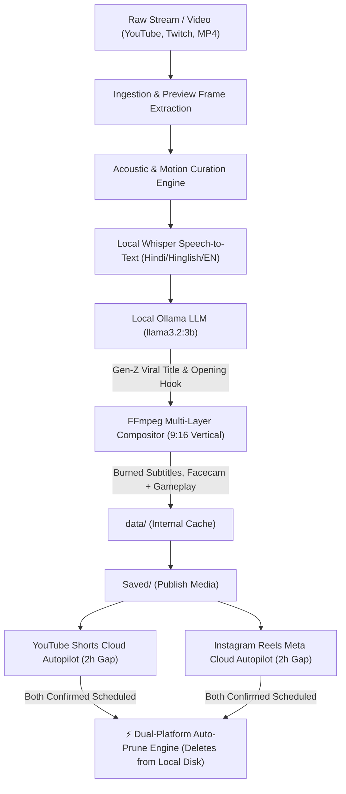
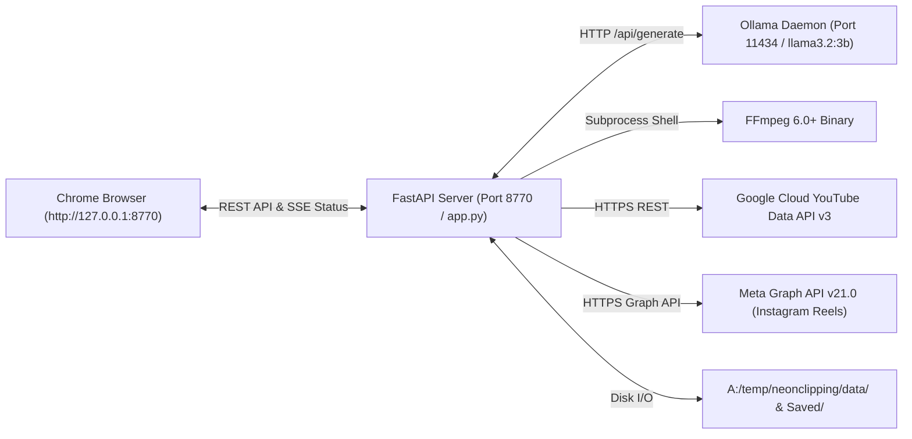

# 📑 NEONCLIPPING STUDIO 2.0 — MASTER ARCHITECTURE & DEVELOPER HANDOFF MANUAL
> **Document Type:** Production Engineering Handoff & System Architecture Blueprint  
> **Status:** Production-Ready / Stable (v2.0)  
> **Target Audience:** Incoming Senior Full-Stack Engineers, AI Pipeline Developers, DevOps & Media Distribution Architects  
> **Language:** Professional Technical Hinglish (English terminology with clear Roman Hindi walkthrough)  
> **Cost Guarantee:** **$0 Forever (100% Free Open-Source & Local AI Stack)**

---

## 🧭 TABLE OF CONTENTS
1. [Executive Summary & System Philosophy](#1-executive-summary--system-philosophy)
2. [End-to-End Technology Stack ($0 Stack)](#2-end-to-end-technology-stack-0-stack)
3. [Repository Directory & Complete File Map](#3-repository-directory--complete-file-map)
4. [Local Daemons & Background Services Architecture](#4-local-daemons--background-services-architecture)
5. [Deep Dive: Core System Workflows & Pipelines](#5-deep-dive-core-system-workflows--pipelines)
   - 5.1 [Video Cutout Pipeline (⚡ 1-Click Auto Mode vs ✂️ Manual Mode)](#51-video-cutout-pipeline)
   - 5.2 [Local AI Gen-Z Viral Title & Hook Engine (Ollama llama3.2:3b)](#52-local-ai-gen-z-viral-title--hook-engine)
   - 5.3 [Stream Cutout Pipeline (Live IRC Chat Hype Clipper)](#53-stream-cutout-pipeline)
   - 5.4 [Multi-Tier Storage Architecture & The Dual-Platform Auto-Prune Engine](#54-multi-tier-storage-architecture--the-dual-platform-auto-prune-engine)
   - 5.5 [YouTube Shorts 1-Click Cloud Autopilot Pipeline](#55-youtube-shorts-1-click-cloud-autopilot-pipeline)
   - 5.6 [Instagram Reels Meta Cloud Pre-Staging Pipeline](#56-instagram-reels-meta-cloud-pre-staging-pipeline)
6. [Critical Vulnerabilities, Pitfalls & "DO NOT TOUCH" Rules](#6-critical-vulnerabilities-pitfalls--do-not-touch-rules)
7. [API Contract Reference (Internal Backend Endpoints)](#7-api-contract-reference)
8. [Developer Quickstart & Maintenance Guide](#8-developer-quickstart--maintenance-guide)

---

## 1. EXECUTIVE SUMMARY & SYSTEM PHILOSOPHY

### Kya Hai NeonClipping Studio 2.0?
**NeonClipping Studio 2.0** ek autonomous local AI desktop platform hai jo lambi horizontal gameplay streams (YouTube, Twitch, Kick) aur pre-recorded videos ko high-retention, viral 9:16 vertical Shorts, Reels, aur TikToks me convert karta hai. 

Iske saath hi isme **Autonomous Multi-Platform Cloud Distribution** built-in hai jo bina kisi manual intervention ke YouTube Shorts aur Instagram Reels par scheduled cadence (jaise 2-hour staggered intervals) ke saath videos push kar deta hai.

### The 3 Core Philosophies:
1. **$0 Forever (Zero Paid SaaS APIs):** Koi paid transcription API (jaise AssemblyAI ya OpenAI Whisper API) nahi, koi paid LLM API (jaise GPT-4) nahi, aur koi paid social scheduler (jaise Buffer ya Hootsuite) nahi. Sab kuch local CPU/GPU aur free official cloud APIs (Google Cloud YouTube Data API v3 & Meta Graph API v21.0) par chalta hai.
2. **Zero-PC Cloud Independence:** User ko apna heavy gaming PC raat bhar on rakhne ki zaroorat nahi hai. Ek baar 1-Click Autopilot launch ho gaya, videos cloud par pre-stage/scheduled ho jaate hain aur user turant computer shutdown kar sakta hai.
3. **Strict Storage Optimization:** Heavy streaming videos local disk space ko bohot jaldi bhar deti hain. System me dual-schedule auto-delete engine hai jo clips ke dono platforms par schedule/publish hote hi unhe hard disk se purge kar deta hai.



---

## 2. END-TO-END TECHNOLOGY STACK ($0 STACK)

| Component | Technology / Library | Purpose in NeonClipping |
| :--- | :--- | :--- |
| **Backend Framework** | `FastAPI` + `Uvicorn` (Python 3.10+) | High-throughput asynchronous local HTTP server running on `http://127.0.0.1:8770`. |
| **Media Processing** | `FFmpeg` & `FFprobe` | High-performance video slicing, audio extraction, facecam cropping, subtitle burn-in, filters. |
| **Video Downloader** | `yt-dlp` | Reliable stream & VOD downloading from YouTube, Twitch, Kick with chunking. |
| **Speech-to-Text** | Local `faster-whisper` / `whisper` | 100% offline transcription supporting Hindi, Hinglish, English (`base` and `large-v3`). |
| **Local LLM Engine** | `Ollama` daemon (`llama3.2:3b`) | High-speed local reasoning on port `11434` for viral Gen-Z title and hook generation. |
| **YouTube Publishing** | `google-api-python-client`, `google-auth-oauthlib` | Official YouTube Data API v3 OAuth 2.0 flow with chunked resumable video uploads. |
| **Instagram Publishing**| Meta Graph API v21.0 via `urllib` / `requests` | Long-lived Page Access Token flow, container initialization, video pre-staging. |
| **Task Queue / History**| SQLite3 (`jobs.sqlite3`) + JSON Stores | Persistent state tracking for publish history, background rendering, cloud queue. |
| **Frontend UI** | Vanilla ES6+ JavaScript, CSS3 Variables, Semantic HTML5 | Zero-framework, zero-build ultra-fast web UI with real-time SSE progress polling. |

---

## 3. REPOSITORY DIRECTORY & COMPLETE FILE MAP

Agle developer ke liye repository ka har folder aur file ka purpose yahan detailed hai:

```
A:\temp\neonclipping\
│
├── app.py                      # [CRITICAL] Main FastAPI backend server & pipeline coordinator (port 8770)
├── smart.py                    # [CRITICAL] Ollama LLM client, viral title generator, auto-boot daemon
├── saved_clips.py              # Publish Media API router (/saved, /saved/clear, /saved/ai-retitle)
├── sources.py                  # Storage & Sources router (/sources, /sources/clear, get_source_videos)
├── youtube_uploader.py         # YouTube OAuth2.0 authentication, batch upload & 2h gap scheduler
├── instagram_publisher.py      # Meta Graph API integration, Reels upload & cloud scheduler
├── publisher_scheduler.py      # Universal cloud scheduler, quota tracker, and dual-schedule auto-prune
├── curation.py                 # Highlight heuristics, transcript NLP payoff scoring, filter rules
├── highlights.py               # Video acoustic (RMS volume) & motion vector spike analyzer
├── captions.py                 # Whisper model loader, audio transcription, Hinglish transliteration
├── facecam_detect.py           # Computer vision face detection for auto-locating streamer webcam
├── live_session.py             # Live stream buffer recorder (before 24s, after 14s)
├── stream_clipper.py           # Real-time Twitch/YouTube Live chat hype detector (chat speed spikes)
├── subtitles.py                # Subtitle format parsers (.srt, .vtt, .ass), word animations
├── styling.py                  # Visual template presets (X post, TikTok hook, Breaking News)
├── brands.py                   # Branding overlays, watermark placement, outro animations
├── hooks.py                    # On-screen curiosity hook generator & styling
├── vision.py                   # Visual review helper for multimodal verification
├── bundles.py                  # ZIP bundle exporter for bulk clip downloads
├── translit.py                 # Devanagari to Hinglish phonetic converter
├── reedit.py                   # Re-editing existing rendered clips without full re-transcription
│
├── index.html                  # [CRITICAL] Single-page studio interface (Dashboard, Cutout, Saved, etc.)
├── assets/
│   ├── app.js                  # [CRITICAL] Core frontend JavaScript: DOM events, API client, live player
│   ├── style.css               # Studio 2.0 Dark Neon theme, responsive grids, animated progress tracks
│   ├── extras.js               # Secondary UI helpers: AI chat panel, modal dialogs, phone remote
│   ├── vision.js               # Visual review canvas helpers
│   └── NeonClip.png            # Application branding icon
│
├── data/                       # [CRITICAL - INTERNAL STUDIO CACHE]
│   ├── publish_history.json    # Persistent record of all YouTube & Instagram published/scheduled clips
│   ├── ig_cloud_queue.json     # Meta cloud pre-staging queue and container tracking
│   ├── jobs.sqlite3            # Background job worker state persistence
│   ├── models/                 # Cached Whisper weights (base, large-v3)
│   ├── transcripts/            # Cached full-length source transcripts
│   └── {clip_id}.*             # Internal clip rendering cache (.mp4, .json, .srt, .ass)
│
├── Saved/                      # [CRITICAL - ISOLATED PUBLISH MEDIA DIRECTORY]
│   ├── {Title} - {short_id}.mp4# Final rendered upload-ready clips ready for YouTube & Instagram
│   └── {Title} - {short_id}.srt# Accompanying subtitle files for upload
│
├── client_secrets.json         # Google Cloud OAuth 2.0 desktop app credentials (Download from GCP)
├── token.json                  # Active user OAuth 2.0 refresh & access tokens for YouTube
├── instagram_credentials.json  # Meta Graph API Page Token, Instagram Account ID, expiry timestamps
│
├── launch.bat                  # [RECOMMENDED LAUNCHER] Windows batch file with Ollama auto-boot & proxy scrub
├── run.ps1                     # Alternative PowerShell launcher
├── requirements.txt            # Python dependencies (fastapi, uvicorn, yt-dlp, faster-whisper, etc.)
└── .venv/                      # Python virtual environment containing installed packages
```

---

## 4. LOCAL DAEMONS & BACKGROUND SERVICES ARCHITECTURE

NeonClipping 2.0 runs as a coordinated local microservice ecosystem:



### 1. NeonClipping FastAPI Server (`port 8770`)
* **Entrypoint:** `app.py`
* **Command:** `.\.venv\Scripts\python.exe app.py`
* **Responsibilities:** Serves static frontend files (`index.html`, `assets/`), exposes REST APIs for clipping, handles background threads for video rendering, and interfaces with social uploaders.

### 2. Ollama Local LLM Daemon (`port 11434`)
* **Binary:** `C:\Users\R7\AppData\Local\Programs\Ollama\ollama.exe`
* **Active Model:** `llama3.2:3b` (~2.0 GB on disk)
* **Responsibilities:**
  - Fast, local, private inference on clip transcripts.
  - Generates viral Gen-Z Shorts titles (maximum 7 words).
  - Generates curiosity opening hooks and Instagram hashtags.
* **Auto-Boot:** `smart.ensure_ollama()` and `launch.bat` check port 11434. If unreachable, `ollama serve` is automatically spawned in the background.

---

## 5. DEEP DIVE: CORE SYSTEM WORKFLOWS & PIPELINES

### 5.1 VIDEO CUTOUT PIPELINE

Video Cutout do distinct modes me operate karta hai:

#### Mode A: ⚡ 1-Click Auto Mode (`#video-auto-container`)
* **Intended Use:** Creator pastes a link, picks format options in 1 single row, and clicks `⚡ Make clips`. Everything else is autonomous.
* **Format Row Controls:**
  1. `Caption accuracy` (`#accurate`): `fast` (YouTube captions) vs `best` (Whisper large-v3).
  2. `Mode` (`#mode`): `fast` (~2-3 mins) vs `deep` (slower, acoustic & speech deep scan).
  3. `Moment mix` (`#moment-profile`): `balanced`, `action` (high energy), `dialogue` (story & humour).
  4. `Clips` (`#count`): Total clips to export (1 to 12).
  5. `Min length` (`#minlen`) & `Max length` (`#length`): Duration bounds (e.g. 30s to 60s).
* **Under the Hood (`/make` in `app.py`):**
  1. Downloads low-res video stream or audio using `yt-dlp`.
  2. If YouTube captions exist, fetches them instantly (`fast` path). Otherwise, runs Whisper speech recognition.
  3. Identifies candidate moments using `highlights.py` (volume peaks) and `curation.py` (NLP dialogue payoffs).
  4. Calls `smart.generate_title_and_hook()` to get Gen-Z titles.
  5. Slices the exact video segments in high quality, detects facecam with `facecam_detect.py`, stacks webcam above gameplay (9:16 vertical 1080x1920), burns GTA Neon animated captions, and copies final output into `Saved/`.

#### Mode B: ✂️ Manual Clipping (`#video-manual-container`)
* **Intended Use:** Power user who wants full creative control over bounding boxes, subtitle timings, and card templates.
* **Features:**
  - Interactive HTML5 Canvas frame preview (`#source`) to manually draw Facecam & Gameplay boxes.
  - Video scrub bar with Start/End seconds inputs.
  - Subtitle styling selector (GTA Neon, Impact, Hormozi, MrBeast, Clean).
  - Word-level subtitle timing editor with time-shift controls.
  - Style overlays: X Post card templates, brand logos, watermarks, custom background colours/blur, background music ducking.
  - Manual export bar (`Export clip ↗` / `Export video highlights`).

---

### 5.2 LOCAL AI GEN-Z VIRAL TITLE & HOOK ENGINE

Pehle system me ek bada bottleneck tha: clips ke naam raw placeholder bann jaate the jaise `"Live clip - f568bd.mp4"` ya `"Dialogue candidate - 7373bd.mp4"`.

Humne isko completely eliminate karke **4-Pillar Local AI Viral Title Engine** integrate kiya hai:

```python
# From smart.py
def generate_title_and_hook(text, stream_title="", language=None):
    """
    1. Checks if Ollama is running (auto-boots if offline).
    2. Sends prompt requesting punchy Gen-Z meme title (max 7 words) + opening hook.
    3. Validates that output does not contain banned generic phrases ('Live clip', 'Dialogue candidate').
    4. If Ollama is unavailable, uses NLP heuristic (curation.extract_hook) from actual spoken words.
    """
```

#### Results Comparison:
| Old Placeholder Title (Banned) | Upgraded Ollama Gen-Z Viral Title |
| :--- | :--- |
| `Live clip - 1ab8d3.mp4` | **`Bro actually tried explaining Hindi to his grandma - 1ab8d3.mp4`** |
| `Live clip - f568bd.mp4` | **`She doesn't always make the best choice - f568bd.mp4`** |
| `Dialogue candidate - 7373bd.mp4` | **`Bro can't reload his own game - 7373bd.mp4`** |
| `Dialogue candidate - d99cba.mp4` | **`Bro gave Speed a whole box of pizza - d99cba.mp4`** |
| `Activity highlight 1 - e65334.mp4` | **`Danny Talio's Epic Roast - e65334.mp4`** |

> [!IMPORTANT]
> **Preserving Short IDs:** Har filename ke end me ` - {short_id}.mp4` hamesha rehta hai (e.g. `Bro can't reload his own game - 7373bd.mp4`). Ye short ID YouTube aur Instagram schedulers ke liye unique primary key hoti hai. **Is pattern ko kabhi remove mat karna!**

---

### 5.3 STREAM CUTOUT PIPELINE (LIVE IRC CHAT HYPE CLIPPER)

* **Entrypoint:** `stream_clipper.py` & `live_session.py`
* **How It Works:**
  1. Streamer Twitch channel ya YouTube Live link paste karta hai (`/live/start`).
  2. NeonClipping background me live audio/video stream record karta hai rolling circular buffer me.
  3. Saath hi live Twitch IRC chat ya YouTube chat messages ki frequency monitor karta hai.
  4. Jab chat speed me achanak spike aata hai (e.g. audience spamming "LMAO", "OMG", "W", "POG", emotes), engine us spike se **24 seconds pehle aur 14 seconds baad** ka video instantly slice kar leta hai.
  5. Clip turant transcribe hoti hai, Ollama viral title generate karta hai, aur vertical 9:16 clip ban kar `Saved/` me save ho jaati hai!

---

### 5.4 MULTI-TIER STORAGE ARCHITECTURE & THE DUAL-PLATFORM AUTO-PRUNE ENGINE

NeonClipping me 3 alag-alag storage layers hain. Agle developer ko inki strict boundaries samajhna bohot zaroori hai:

```
[Layer 1: Sources] A:\temp\neonclipping\data\{source_id}.mp4
                   └── Original heavy stream download (2-10 GB). Cleared via Storage & Sources tab.

[Layer 2: Cache]   A:\temp\neonclipping\data\{clip_id}.mp4
                   └── Studio internal rendering cache. Cleared via My Clips Cache tab.

[Layer 3: Saved]   A:\temp\neonclipping\Saved\{Title} - {short_id}.mp4
                   └── Upload-ready final videos for YouTube & Instagram.
```

#### ⚡ The Dual-Platform Auto-Prune Engine (`publisher_scheduler.py`):
Pehle sabse badi problem ye thi ki jab clips YouTube aur Instagram dono par successfully schedule ho jaate the, tab bhi wo local disk par pade rehte the aur memory bhar jaati thi.

Humne `prune_dual_scheduled()` implement kiya:
1. Har baar jab clip schedule hoti hai ya `/saved` list load hoti hai, engine `data/publish_history.json` ko scan karta hai.
2. Agar koi clip **Instagram (published/scheduled)** AND **YouTube (published/scheduled)** dono me confirmed record ho chuki hai:
   - File ko `Saved/` folder se **permanently delete** kar diya jaata hai.
   - Uske internal `data/` cache ko bhi clean kar diya jaata hai.
   - **Result:** Local disk par sirf wahi clips bachte hain jinka YouTube ya Instagram publish abhi baaki hai!

---

### 5.5 YOUTUBE SHORTS 1-CLICK CLOUD AUTOPILOT PIPELINE

* **Module:** `youtube_uploader.py` & `publisher_scheduler.py`
* **OAuth Setup:** `client_secrets.json` (Google Cloud Desktop Application) se auth token exchange hota hai aur `token.json` me offline access token & refresh token persist hota hai.
* **Daily Quota Management:**
  - YouTube Data API v3 free tier: **10,000 units / day**.
  - 1 video upload = ~1,600 units.
  - **Safe daily limit:** **6 Shorts / day** (UI monitors quota and displays remaining count: e.g. `5 / 6 Shorts`).
  - Quota reset time: **1:30 PM IST (Midnight PST)** automatically calculated in UI.
* **Cadence Scheduling (2-Hour Gap):**
  - Jab user `Auto-Schedule Top 5 Shorts (2h Gap)` dabata hai:
    - Clip 1: Released after 2 hours (e.g. 03:30 PM IST)
    - Clip 2: Released after 4 hours (e.g. 05:30 PM IST)
    - Clip 3: Released after 6 hours (e.g. 07:30 PM IST)
    - Clip 4: Released after 8 hours (e.g. 09:30 PM IST)
    - Clip 5: Released after 10 hours (e.g. 11:30 PM IST)
  - Time format: Google Cloud API ko UTC ISO-8601 timestamp chahiye hota hai (`publishAt: "2026-11-23T10:00:00Z"`). UI me ise convert karke local Indian Standard Time (IST) me display kiya jaata hai.
* **100% Zero-PC Cloud Safety:** Videos YouTube Cloud par upload hoke private state me baith jaate hain aur YouTube ka server scheduled time par unhe public karta hai. **User upload khatam hote hi PC switch off kar sakta hai!**

---

### 5.6 INSTAGRAM REELS META CLOUD PRE-STAGING PIPELINE

* **Module:** `instagram_publisher.py` & `publisher_scheduler.py`
* **Meta Graph API v21.0 Flow:**
  1. User Token exchange hota hai 60-day long-lived token ke liye.
  2. Connected Facebook Page ke through linked Instagram Business / Creator Account ID detect hoti hai.
  3. Credentials persist hote hain `instagram_credentials.json` me.
* **Meta Cloud Pre-Staging (Zero-PC Guarantee):**
  - Video ko Meta Cloud par upload karke ek media container banaya jaata hai (`POST /{ig-user-id}/media`).
  - Meta se container `creation_id` milta hai aur status `FINISHED` hone tak verify hota hai.
  - Once verified, task queue me schedule time store ho jaata hai.

---

## 6. CRITICAL VULNERABILITIES, PITFALLS & "DO NOT TOUCH" RULES

Agle developer ke liye ye **MUST-READ** section hai. Yahan un galtiyon ki list hai jo system ko instantly break kar sakti hain:

### ⚠️ Rule 1: Windows PowerShell Command Separator Issue
* **Problem:** Windows PowerShell me bash ka `&&` operator syntax error throw karta hai (`The token '&&' is not a valid statement separator`).
* **Fix:** PowerShell commands ko hamesha `;` se separate karein ya script blocks use karein. Example:
  ```powershell
  # WRONG (Throws Error):
  Set-Location "A:\temp\neonclipping" && python app.py
  
  # CORRECT:
  Set-Location "A:\temp\neonclipping"; python app.py
  ```

### ⚠️ Rule 2: System Proxy Pollution Breaks OAuth & Cloud APIs
* **Problem:** Agar user ke PC par koi proxy tool (v2ray, clash, local VPN, socks5) chal raha ho, toh Windows environment variables me `HTTP_PROXY`, `HTTPS_PROXY`, ya `ALL_PROXY` set ho jaate hain. Isse Google OAuth (`accounts.google.com`), YouTube uploader, aur Meta Graph API **WinError 10061 (Connection Refused)** dekar fail ho jaate hain!
* **Mandatory Pattern:** Hamesha Python start karne se pehle proxy variables unset karein (jaise `launch.bat` me kiya gaya hai):
  ```bat
  set HTTP_PROXY=
  set HTTPS_PROXY=
  set ALL_PROXY=
  ```

### ⚠️ Rule 3: Do NOT Alter the Filename Pattern (`{Title} - {short_id}.mp4`)
* **Problem:** Schedulers (`publisher_scheduler.py`, `youtube_uploader.py`, `instagram_publisher.py`) clip ka 6-hex unique ID filename ke aakhri part se nikalte hain (`stem.rsplit(' - ', 1)[1]`).
* Agar aapne filename me se ` - {short_id}` hata diya, toh:
  - Dual-schedule auto-prune fail ho jayega.
  - Quota tracker duplicate clips schedule kar dega.
  - History maps corrupt ho jayenge.

### ⚠️ Rule 4: Data Cache Clear Must Whitelist System Records
* **Problem:** `app.py` me `@app.post('/library/clear')` studio internal cache ko delete karta hai.
* **Rule:** `publish_history.json`, `ig_cloud_queue.json`, `jobs.sqlite3`, `models/`, aur `transcripts/` ko kabhi delete mat hone dena! Agar ye delete ho gaye, toh user ke scheduled releases aur channel quota ki memory hamesha ke liye mit jayegi.

### ⚠️ Rule 5: Windows Socket Zombie Port Locks (`FinWait2`)
* **Problem:** Jab Uvicorn / FastAPI process band hoti hai, Windows socket turant release nahi hota aur `FinWait2` state me rehta hai. Naya process start karne par `[Errno 10048] address already in use` error aata hai.
* **Fix:** Port 8770 ko bind karne se pehle process ko force kill karein aur 1-2 second ka pause lein.

### ⚠️ Rule 6: Ollama CPU Inference Timeout
* **Problem:** Low-end PCs par jab Ollama CPU mode me chalta hai (Vulkan iGPU dropped), toh 3B parameter model response dene me 2-6 seconds leta hai.
* **Rule:** `smart.py` me `urllib.request.urlopen(req, timeout=90)` ka timeout kam se kam 60-90 seconds rakhein. 5-10 second ka chhota timeout model inference ke beech me connection abort kar dega.

---

## 7. API CONTRACT REFERENCE (INTERNAL BACKEND)

Agle developer ke liye major REST API endpoints:

| Endpoint | Method | Input Parameters | Output Response | Description |
| :--- | :--- | :--- | :--- | :--- |
| `/make` | `POST` | `url`, `count`, `mode`, `length`, `minlen`, `layout`, `accurate` | `{job: "uuid"}` | Slices video into AI-curated vertical 9:16 clips with captions. |
| `/saved` | `GET` | None | `{clips: [...], total_count, total_gb}` | Lists upload-ready clips in `Saved/` with IST timestamps & status. |
| `/saved/ai-retitle` | `POST` | None | `{ok: true, count: N, renamed: [...]}` | Scans generic clips in `Saved/`, calls Ollama, updates to Gen-Z titles. |
| `/saved/clear` | `POST` | None | `{ok: true, count: N, freed_mb: X}` | Deletes all rendered MP4s and SRTs from `Saved/`. |
| `/sources/clear` | `POST` | None | `{ok: true, count: N, freed_gb: X}` | Deletes heavy source video downloads from `data/`. |
| `/library/clear` | `POST` | None | `{ok: true, count: N, freed_mb: X}` | Clears studio internal rendered cache while protecting history. |
| `/youtube/status` | `GET` | None | `{connected: bool, channel: {...}}` | Checks active YouTube OAuth token and channel health. |
| `/youtube/batch-schedule` | `POST` | `{clips: [...], interval_hours: 2}` | `{batch_id, count}` | Launches 2-hour staggered YouTube Shorts cloud upload. |
| `/publishing/scheduled` | `GET` | `?platform=youtube` / `instagram` | `{scheduled: [...]}` | Returns active scheduled cloud queue with release times. |
| `/publishing/quotas` | `GET` | None | `{youtube: {used, max, reset_time}}` | Returns daily API quota usage (e.g. 5/6 shorts). |

---

## 8. DEVELOPER QUICKSTART & MAINTENANCE GUIDE

### How to Run the App (Zero Errors):
1. Terminal open karein aur working directory me jayein:
   ```powershell
   Set-Location "A:\temp\neonclipping"
   ```
2. Virtual environment activate karke app launch karein:
   ```powershell
   Remove-Item env:HTTP_PROXY -ErrorAction SilentlyContinue
   Remove-Item env:HTTPS_PROXY -ErrorAction SilentlyContinue
   Remove-Item env:ALL_PROXY -ErrorAction SilentlyContinue
   .\.venv\Scripts\python.exe app.py
   ```
3. Ya sabse aasaan tareeqa: Desktop icon ya `launch.bat` par double-click karein!

### How to Test Changes:
* **Syntax Validation:** `python -m py_compile app.py smart.py saved_clips.py`
* **Check Ollama Connection:**
  ```powershell
  Invoke-RestMethod -Uri "http://127.0.0.1:11434/api/tags"
  ```
* **Git Commit & Push:**
  ```powershell
  git add -A; git commit -m "your message"; git push origin main
  ```

---

> **Final Note from Lead Architect:**  
> NeonClipping Studio 2.0 is designed as a self-healing, zero-cost, high-velocity content engine. Treat the file separation and scheduling patterns with care, and this codebase will scale smoothly to millions of views without costing a single penny. Happy coding! 🚀
